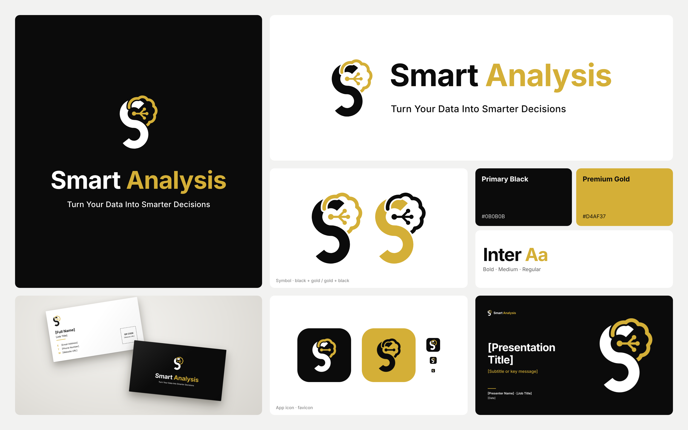

# Smart Analysis — Brand Identity Package

**Turn Your Data Into Smarter Decisions**



## The symbol

The mark uses two elements and nothing else: the letter **S** and an **AI brain**,
woven together into one form. The brain's front lobe arches over the head of the S,
the S's tip cuts under the brain's edge into its interior, and the brain's last lobe
tucks back under the S at the spine, with a small gap at every crossing. The S's upper
bowl is the inside of the brain. A hub at the centre of that bowl sends three circuit
traces to three nodes, showing data turning into reasoning.

- **Primary Black** `#0B0B0B`: the S, type and backgrounds
- **Premium Gold** `#D4AF37`: the brain, circuit, the word *Analysis* and accents
- **Typeface:** Inter (Bold for the wordmark, Medium for the tagline, Regular for body text)

All master artwork uses solid vector fills. The logo files contain no gradients,
effects, embedded raster images or live fonts (the wordmark is converted to outlines).
The over/under weave uses SVG masks, which Illustrator opens as opacity masks and Figma as masks.

## Contents

| Folder | What's inside |
|---|---|
| `logos/svg`, `logos/png` | **Primary** (symbol + wordmark + tagline), **horizontal**, **stacked**, **stacked-tagline** and **symbol**, each in six colourways: `light` (black + gold), `dark` (white + gold for dark backgrounds), `gold-s` (gold S + black brain), `mono-black`, `mono-white`, `mono-gold`. The PNGs are high-resolution with transparent backgrounds. |
| `icons/` | App icon (black, gold, light and full-bleed square), `favicon.svg`, `favicon.ico`, `favicon-transparent.svg`, and PNGs from 16 to 1024 px including `apple-touch-icon-180.png`. |
| `previews/` | High-resolution previews of the primary logo on light and dark backgrounds, plus all variations on one board. |
| `guidelines/` | **Brand guidelines PDF** (15 pages), logo construction sheet (SVG/PNG), usage and spacing guide, misuse sheet, colour palette sheet, typography specification sheet (PNG + PDF). |
| `business-card/` | Front and back sources as SVG (90 × 50 mm plus 3 mm bleed, text is editable), a print-ready 2-page PDF, 600 dpi PNG previews (trimmed and with bleed), a bleed and safe-area guide, and a mockup. |
| `templates/` | Website logos (`@1x`/`@2x`), social profile icon, LinkedIn logo and cover, social post template (1080²), product announcement template (1200 × 675), HTML email signature, presentation title slide (16:9), A4 letterhead (SVG + PDF). |
| `smart-analysis-brand-board.png` | Presentation board of the complete identity. |
| `source/` | `build.py` regenerates every asset from the master geometry in `core.py`. |

## Placeholders

The package contains no invented contact details. Fields like `[Full Name]`, `[Job Title]`,
`[Email Address]`, `[Phone Number]` and `[Website URL]` are live text in the SVG
templates, so you can edit them in Illustrator, Figma or Inkscape.

To print a real QR code on the business card, rebuild with your website:

```bash
pip install playwright fonttools uharfbuzz pillow qrcode
python3 brand/source/build.py --website https://your-domain.com
```

The build needs Chromium (Playwright) and the Inter font installed on the system.

For the email signature, host `templates/email-signature/email-signature-logo.png`
on your website, then replace the `src` placeholder in `email-signature.html` with its URL.

## Key rules (summary)

- **Clear space:** X = ¼ of the symbol height on every side.
- **Minimum sizes:** primary logo 200 px / 50 mm wide · horizontal 120 px / 30 mm wide ·
  symbol 24 px / 7 mm tall. Below 24 px, use the simplified favicon symbol.
- Gold on white has a contrast ratio of 2.1 : 1. Use it for the logo and large display
  type only, never for body text.
- Don't stretch, rotate, recolour, outline or rearrange the logo, and don't add effects.
  Don't introduce any other accent colours.

## Print notes

- Business card: 90 × 50 mm trim with 3 mm bleed (96 × 56 mm document). Keep text
  3 mm inside the trim. For the black front, use rich black (C60 M40 Y40 K100).
- Optional finish: gold foil on the AI brain and on "Analysis".
- The gold CMYK values (0/17/74/17) and the Pantone references are approximations.
  Approve a printed proof before a production run.
